# SpinCycle Bikes – Campus Bike-Sharing REST API

**SpinCycle Bikes** is a RESTful backend web service built with **Node.js**, **Express.js**, and **SQLite** to digitize and manage campus bicycle sharing. Developed for **Backend Development Fundamentals (Group Assignment – 01)**, it replaces manual paper-notebook bike borrowing logs with structured relational storage, full bicycle CRUD operations, rider registration, rental tracking with SQL `INNER JOIN` reporting, case-insensitive bike-type search, pagination, and input validation.

---

## Project Identity

| Attribute | Details |
|---|---|
| **Project Name** | SpinCycle Bikes |
| **Assignment** | Group Assignment – 01 |
| **Group Number** | Group 03 |
| **Group Code** | `YG-CSE2E-G03` |
| **Course** | Backend Development Fundamentals |
| **Programme** | B.Tech – Computer Science and Engineering |
| **Academic Level** | Year II |
| **Project Type** | Backend Development / REST API |
| **Application Domain** | Campus Bike-Sharing System |
| **Institution** | AURORA DEEMED UNIVERSITY |
| **Faculty / Instructor** | Mr. Yugandhar Gurjalwar |
| **Academic Year / Term** | Year II, Term II |
| **Submission Date** | 15 November 2026 |

---

## Project Links

| Platform | Link |
|---|---|
| GitHub Repository | https://github.com/ssrssudharshanreddy/SpinCycle-Bikes |
| Live Application (Render) | https://spincycle-bikes-ukfh.onrender.com |
| API Base URL | https://spincycle-bikes-ukfh.onrender.com |
| Health Check | https://spincycle-bikes-ukfh.onrender.com/health |

> **Local vs. Public URL:** The public API is live on Render at **`https://spincycle-bikes-ukfh.onrender.com`**. For local development and testing, the Express server runs on **`http://localhost:3000`** (for example, `http://localhost:3000/health`).

---

## Table of Contents

- [Project Identity](#project-identity)
- [Project Links](#project-links)
1. [Project Overview](#1-project-overview)
2. [Technology Stack](#2-technology-stack)
3. [Project Structure](#3-project-structure)
4. [System Architecture](#4-system-architecture)
5. [Database Documentation](#5-database-documentation)
6. [Complete REST API Documentation](#6-complete-rest-api-documentation)
7. [Search Functionality](#7-search-functionality)
8. [Pagination](#8-pagination)
9. [Validation and Error Handling](#9-validation-and-error-handling)
10. [Installation and Execution](#10-installation-and-execution)
- [Deployment Information](#deployment-information)
11. [Testing and Screenshots](#11-testing-and-screenshots)
12. [Group Members and Individual Contributions](#12-group-members-and-individual-contributions)
13. [Learning Outcomes](#13-learning-outcomes)
14. [Project Scope and Limitations](#14-project-scope-and-limitations)
15. [Conclusion](#15-conclusion)

---

## 1. Project Overview

### Background

Campus bike-sharing setups help students commute quickly between academic blocks, hostels, and libraries. When managed informally on paper, tracking which student has borrowed which bicycle—and whether a bicycle is currently available or still out on a trip—becomes error-prone as the number of riders and bicycles grows.

### Problem Statement

In a manual notebook-based bike borrowing workflow, campus coordinators and students face several practical issues:

- **Manual notebook-based bike borrowing:** Writing borrower names, student IDs, and timestamps by hand is slow and prone to illegible or incomplete entries.
- **Difficulty maintaining rider records:** Repeated entries in a logbook lead to inconsistent student details and make it hard to verify whether a student is already registered.
- **Difficulty tracking available and borrowed bikes:** Determining which bicycles are currently in use versus available requires scanning through past log pages.
- **Difficulty maintaining rental history:** Paper logs are vulnerable to damage, loss, or accidental alteration, making historical tracking unreliable.
- **Lack of structured record management:** Searching by bicycle type or viewing clean summaries of who rented which bicycle is not practical without structured queries.

### Proposed Solution

**SpinCycle Bikes** addresses these challenges by providing a centralized backend REST API powered by **Express.js** and backed by a relational **SQLite** database (`database/bikeStore.db`). All bicycles, riders, and rentals are stored in normalized tables with foreign-key constraints, input validation, parameterized SQL queries, and consistent JSON responses.

### Project Objectives

1. Replace manual paper borrowing logs with a normalized SQLite relational database (`riders`, `bikes`, `rentals`).
2. Design and implement a RESTful HTTP API using Node.js and Express.js with consistent JSON responses.
3. Enforce relational integrity via foreign keys and business rules that prevent double-booking an actively rented bicycle and protect historical rental records from accidental deletion.
4. Provide complete CRUD operations for bicycles alongside endpoints for rider registration and rental tracking.
5. Support case-insensitive bike-type search (`?type=`) and SQL `LIMIT`/`OFFSET` pagination (`?page=&limit=`) on `GET /bikes`.
6. Apply strict input validation, parameterized SQL queries, and appropriate HTTP status codes (`200`, `201`, `400`, `404`, `409`, `500`, `503`).

### Project Scope

The system is scoped specifically as a **local backend REST API** for managing bicycle inventory, registered student riders, and bike rental records over HTTP (`http://localhost:3000`). It is designed for API-level interaction and academic demonstration via REST clients rather than serving a web or mobile frontend.

### Intended Users

- **Campus Bike-Sharing Coordinators / Staff:** Manage the bicycle fleet, register student riders, issue new rentals, and inspect rental history.
- **Student Developers & Evaluators:** Test, verify, and integrate the REST API endpoints using tools such as VS Code REST Client (`assignment-01.http`), Postman, browser GET requests, or PowerShell.

### Main Functionalities

- **Server & Database Health Check:** Verify API availability and SQLite connectivity (`GET /health`).
- **Bicycle Inventory Management (CRUD):** List, view, add, update, and safely delete bicycles (`/bikes` and `/bikes/:id`).
- **Bike-Type Filtering & Pagination:** Filter bicycles case-insensitively by `bike_type` and retrieve ordered pages with metadata (`GET /bikes?type=...&page=...&limit=...`).
- **Rider Management:** List registered riders, retrieve a rider by ID, and register new riders with unique `student_id` enforcement (`/riders`, `/riders/:id`).
- **Rental Tracking & Reporting:** View all rentals enriched with `rider_name` and `bike_name` using SQL `INNER JOIN` (`GET /rentals`), and create active rentals while preventing double-booking (`POST /rentals`).

### Expected Benefits

- Eliminates manual logbook errors and duplicate rider registrations.
- Prevents a bicycle with an active rental from being rented to another rider simultaneously.
- Preserves historical rental audit trails by blocking deletion of referenced bicycles.
- Enables fast, predictable querying of bicycle inventory through search and pagination.

---

## 2. Technology Stack

| Technology | Version / Package | Purpose in SpinCycle Bikes |
|---|---|---|
| **Node.js** | `20.18.0` / LTS (`.node-version`) | JavaScript runtime environment executing the Express server and SQLite database layer outside the browser. |
| **Express.js** | `^5.3.0` (`express`) | Web framework used for JSON body parsing (`express.json()`), routing, HTTP request/response handling, 404 handling, and centralized error middleware. |
| **JavaScript** | CommonJS (`require` / `module.exports`) | Primary programming language used across all modules of the application. |
| **SQLite** | Embedded RDBMS (`database/bikeStore.db`) | Lightweight, serverless, file-based relational database storing `riders`, `bikes`, and `rentals` with foreign-key enforcement. |
| **sqlite3** | `^6.0.1` (`sqlite3`) | Node.js SQLite driver used to open `bikeStore.db` and execute parameterized SQL queries wrapped in Promises. |
| **npm** | Included with Node.js | Dependency manager used to install `express` and `sqlite3` (`package.json`, `package-lock.json`) and run the `npm start` script. |
| **REST API (JSON)** | HTTP + JSON | Architectural style exposing resource-oriented endpoints (`/health`, `/bikes`, `/riders`, `/rentals`) with standard HTTP methods and status codes. |
| **VS Code & REST Client** | IDE + `assignment-01.http` | Primary development environment and integrated HTTP request runner (`assignment-01.http`) used to organize and execute endpoint test cases. |
| **Postman / HTTP Testing Tools** | API testing tools | Used alongside browser GET checks, PowerShell (`Invoke-RestMethod`), and `sqlite3.exe` CLI for verifying API behavior and database state. |

---

## 3. Project Structure

The project is organized into a clean, simple, and modular architecture where each of the six group members owns clearly identifiable files corresponding to their official assignment responsibilities:

```text
SpinCycle-Bikes/
├── database/
│   ├── bikeStore.db
│   └── database.js
├── postman/
│   ├── POSTMAN_TEST_REPORT.md
│   └── SpinCycle-Bikes.postman_collection.json
├── screenshots/
├── .gitignore
├── .node-version
├── endpoints.js
├── assignment-01.http
├── package-lock.json
├── package.json
├── pagination.js
├── README.md
├── render.yaml
├── routes.js
├── server.js
├── test.js
└── validation.js
```

> **Note on `node_modules/`:** When you run `npm install` locally, npm generates a `node_modules/` directory containing `express`, `sqlite3`, and their transitive dependencies. `node_modules/` is listed in `.gitignore` and **must not be included in the submission ZIP** or committed to version control.

### File and Module Responsibilities (Six-Member File Ownership)

| File / Directory | Owner | Responsibility |
|---|---|---|
| `server.js` | **Member 1** (Kishore) | Entry point of the Express application. Configures `express.json()` middleware, mounts the central API router (`routes.js`), configures 404 route handling, registers centralized error middleware (`400`/`500`), verifies SQLite database connectivity, and starts the server on port `3000`. |
| `routes.js` | **Member 1** (Kishore) | Central Express Router module (`express.Router()`). Declares all HTTP routes for Health, Bikes (CRUD), Riders, and Rentals, mapping each method and URL path directly to its handler function in `endpoints.js`. |
| `database/database.js` | **Member 2** (Irfan) | Manages the SQLite database connection (`database/bikeStore.db`), executes `PRAGMA foreign_keys = ON` on startup, creates normalized tables (`riders`, `bikes`, `rentals`), seeds initial records if empty, and exports Promise query helpers (`runQuery`, `getOne`, `getAll`, `initializeDatabase`). |
| `database/bikeStore.db` | **Member 2** (Irfan) | Single-file embedded SQLite relational database storing tables and verified records (6 riders, 8 bikes, 6 rentals). |
| `endpoints.js` | **Member 3** (Dinesh) | Implements all REST endpoint handlers: `getHealth`, `getBikes` (integrating search and pagination), `getBikeById`, `createBike`, `updateBike`, `deleteBike` (conflict-protected), `getRiders`, `getRiderById`, `createRider`, `getRentals` (with SQL `INNER JOIN`), and `createRental` (conflict-protected). |
| `validation.js` | **Member 4** (Prasanna) | Reusable input validation and search module: validates integer IDs (`parsePositiveIntId`, `parsePositiveIntField`), non-empty strings (`validateNonEmptyString`), payload schemas (`validateBikePayload`, `validateRiderPayload`), real calendar dates (`validateRentalDate`), and bike-type search parameters (`validateBikeTypeSearch`, `buildBikeTypeSearchClause`). |
| `pagination.js` | **Member 5** (Anshu) | Dedicated pagination module: defines default values (`page=1`, `limit=5`), validates pagination query parameters (`parsePaginationParam`), calculates SQL offset (`calculateOffset = (page - 1) * limit`), builds response metadata (`buildPaginationMetadata`), and integrates search with pagination (`parseBikeQueryParams`). |
| `postman/` | **Member 6** (Sudharshan) | Contains the 40-request Postman Collection v2.1.0 (`SpinCycle-Bikes.postman_collection.json`) organized into 10 folders with pre-configured tests, and the comprehensive test report (`POSTMAN_TEST_REPORT.md`) verifying all test cases with a 100% PASS rate. |
| `test.js` | **Member 6** (Sudharshan) | Standalone reproducible automated test runner verifying 42 test cases (36 core non-mutating tests + 6 isolated lifecycle CRUD tests) against the modular Express app and SQLite database (`npm test` / `node test.js`). |
| `README.md` | **Member 6** (Sudharshan) | Complete academic, architectural, database, API, testing, and contribution documentation for Group Assignment – 01. |
| `assignment-01.http` | Course Resource | Ready-to-run 26-request test suite for the VS Code REST Client extension (formerly `lab-03.http`). |
| `screenshots/` | Course Evidence | Stores all 16 verified screenshot images (`01` through `16`) demonstrating project setup, API operations, and SQLite database verification. |
| `package.json` | Project Config | Application metadata, scripts (`npm start`, `npm run build`, `npm run init-db`), dependencies (`express`, `sqlite3`), and engines configuration. |
| `render.yaml` | Cloud Deployment | Render Blueprint configuration specifying the build command (`npm rebuild sqlite3 --build-from-source`) and startup settings. |
| `.gitignore` & `.node-version` | Git / Runtime | Excludes dependencies, logs, and OS files from version control; specifies Node.js LTS `20.18.0`. |

---

## 4. System Architecture

SpinCycle Bikes follows a clean, modular six-component backend architecture within a single Node.js process:

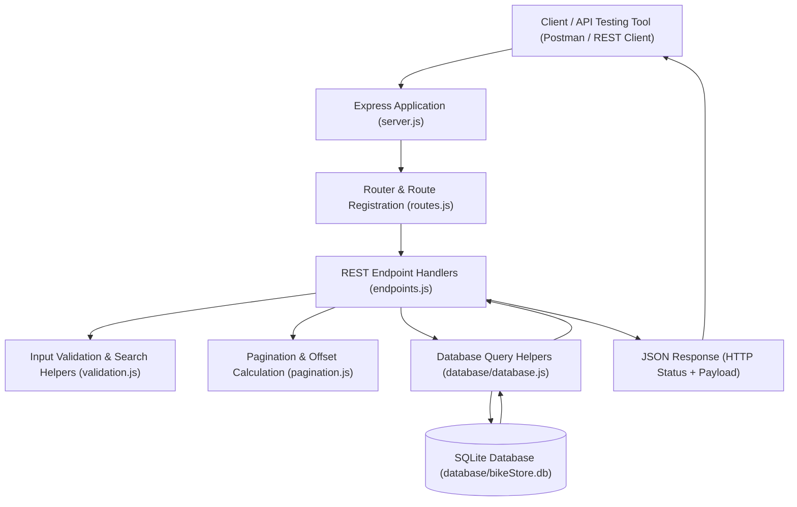

### Module Interactions and Separation of Concerns

1. **Client Request:** A client sends an HTTP request (e.g. `GET /bikes?type=Mountain&page=1&limit=2`).
2. **Server & Router (`server.js` & `routes.js` — Member 1):** `server.js` applies `express.json()` and delegates route resolution to `routes.js`, which directs the request to the appropriate function in `endpoints.js`.
3. **Validation & Search (`validation.js` — Member 4):** Parameter and payload validation routines ensure inputs are well-formed before any database operation executes.
4. **Pagination Logic (`pagination.js` — Member 5):** Validates `page` and `limit`, applies default values, calculates `OFFSET = (page - 1) * limit`, and formats total pagination metadata.
5. **Endpoint Handler (`endpoints.js` — Member 3):** Combines validated inputs, pagination offset, and business rules (e.g., active rental conflict check, deletion referential-integrity protection).
6. **Database Execution (`database/database.js` — Member 2):** Runs parameterized SQL queries against `database/bikeStore.db` safely using Promise wrappers (`getOne`, `getAll`, `runQuery`).
7. **Response Delivery:** The endpoint formats a consistent JSON payload (`200 OK`, `201 Created`, `400 Bad Request`, `404 Not Found`, `409 Conflict`, or `503 Service Unavailable`) and sends it back to the client.

### Architectural Layer & Component Responsibilities

- **Server & Routing Layer (`server.js` & `routes.js` — Member 1):**
  - Initializes the Express application and configures `express.json()` body-parsing middleware.
  - Defines the central router (`routes.js`) mapping HTTP methods and endpoints (`/health`, `/bikes`, `/riders`, `/rentals`) to their corresponding handler functions in `endpoints.js`.
  - Implements the 404 catch-all handler for unknown routes and centralized error-handling middleware (`entity.parse.failed` and safe 500 error responses).
  - Verifies SQLite database connectivity on startup and starts the HTTP server on port `3000`.
- **REST Endpoints Layer (`endpoints.js` — Member 3):**
  - Implements the business logic and HTTP response formatting for all 11 endpoints.
  - Coordinates input validation (Member 4), pagination (Member 5), and database operations (Member 2).
  - Enforces domain business rules: preventing active rental double-booking (`409 Conflict`), enforcing unique student registrations (`409 Conflict`), and protecting historical rental records from cascading bike deletion (`409 Conflict`).
- **Validation & Search Module (`validation.js` — Member 4):**
  - Reusable validators for positive integer IDs, required non-empty trimmed strings, and request bodies for bikes and riders.
  - Calendar date verification (`validateRentalDate`) ensuring real calendar dates before database operations.
  - Parameterized bike-type search helpers (`WHERE LOWER(bike_type) = LOWER(?)`) preventing SQL injection.
- **Pagination Module (`pagination.js` — Member 5):**
  - Manages pagination parameters with defaults (`page = 1`, `limit = 5`).
  - Computes deterministic SQL offsets using `OFFSET = (page - 1) * limit`.
  - Calculates pagination metadata (`totalRecords`, `totalPages`) and coordinates search with pagination.
  - Rejects invalid pagination values (`page = 0`, negative limits, non-numeric values) with `400 Bad Request`.
- **Database Layer (`database/database.js` & `database/bikeStore.db` — Member 2):**
  - Maintains a single `sqlite3.Database` connection to `database/bikeStore.db`.
  - Enables SQLite foreign-key enforcement (`PRAGMA foreign_keys = ON`) on startup.
  - Initializes the three normalized tables (`riders`, `bikes`, `rentals`) and seeds sample data idempotently if empty.
  - Exposes Promise-wrapped helpers (`runQuery`, `getOne`, `getAll`) executing parameterized queries safely.

---

## 5. Database Documentation

The backend uses an embedded SQLite relational database located at `database/bikeStore.db` containing **three normalized tables**: `riders`, `bikes`, and `rentals`.

### Entity-Relationship Diagram

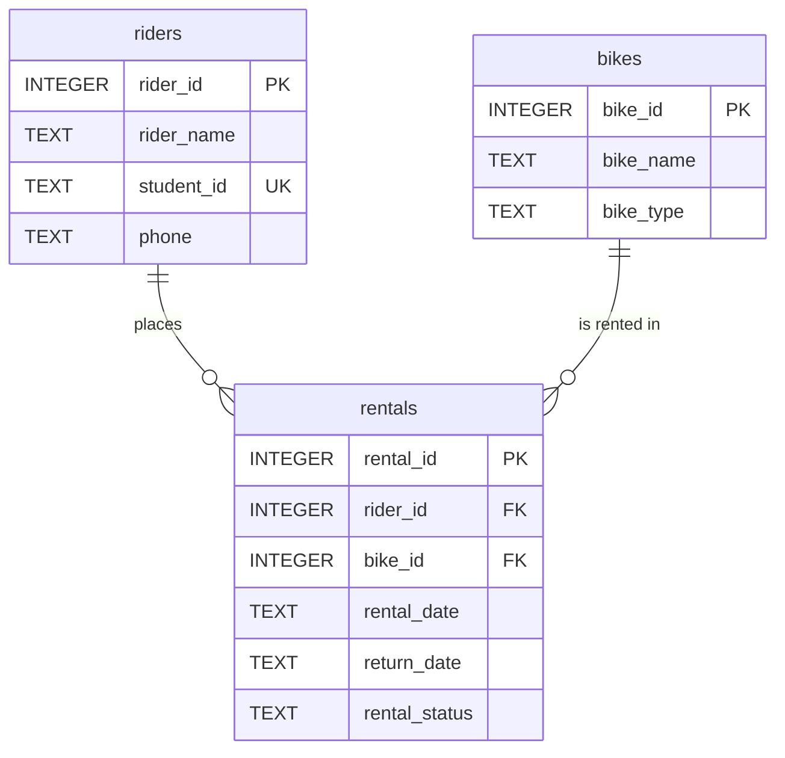

### Table Schemas

#### 1. `riders`

Stores registered campus student riders.

| Column | Data Type | Constraints | Description |
|---|---|---|---|
| `rider_id` | `INTEGER` | `PRIMARY KEY AUTOINCREMENT` | Unique auto-incremented rider identifier. |
| `rider_name` | `TEXT` | `NOT NULL` | Full name of the registered student rider. |
| `student_id` | `TEXT` | `UNIQUE NOT NULL` | Unique campus student identifier; prevents duplicate rider accounts. |
| `phone` | `TEXT` | `NOT NULL` | Contact phone number of the rider. |

#### 2. `bikes`

Stores the campus bicycle inventory.

| Column | Data Type | Constraints | Description |
|---|---|---|---|
| `bike_id` | `INTEGER` | `PRIMARY KEY AUTOINCREMENT` | Unique auto-incremented bicycle identifier. |
| `bike_name` | `TEXT` | `NOT NULL` | Name or model label of the bicycle (e.g., `TrailBlazer X1`). |
| `bike_type` | `TEXT` | `NOT NULL` | Category/type of bicycle (e.g., `Mountain`, `Road`, `Hybrid`, `City`). |

#### 3. `rentals`

Stores borrowing transactions linking riders and bicycles.

| Column | Data Type | Constraints | Description |
|---|---|---|---|
| `rental_id` | `INTEGER` | `PRIMARY KEY AUTOINCREMENT` | Unique auto-incremented rental identifier. |
| `rider_id` | `INTEGER` | `NOT NULL REFERENCES riders(rider_id)` | Foreign key referencing the borrowing rider. |
| `bike_id` | `INTEGER` | `NOT NULL REFERENCES bikes(bike_id)` | Foreign key referencing the borrowed bicycle. |
| `rental_date` | `TEXT` | `NOT NULL` | Date/time string when the bike was rented (e.g., `2026-11-12 14:25:00`). |
| `return_date` | `TEXT` | Nullable | Date/time string when the bike was returned, or `NULL` while active. |
| `rental_status` | `TEXT` | `NOT NULL` | Rental state: `'active'` or `'returned'`. |

#### `rental_status` Values

| Value | Meaning | `return_date` State |
|---|---|---|
| `active` | The bicycle is currently borrowed and has not yet been returned. | `NULL` |
| `returned` | The bicycle rental has been completed and returned. | Timestamp string (e.g., `2026-11-10 11:45:00`) |

### Relational Integrity & Design Rationale

- **Primary Keys (`PRIMARY KEY AUTOINCREMENT`):** `rider_id`, `bike_id`, and `rental_id` uniquely identify each record in their respective tables and allow deterministic sorting (such as `ORDER BY bike_id ASC`).
- **Foreign Keys (`REFERENCES`):** `rentals.rider_id` references `riders(rider_id)` and `rentals.bike_id` references `bikes(bike_id)` with SQLite's default `ON UPDATE NO ACTION` and `ON DELETE NO ACTION`.
- **One-to-Many (`riders` → `rentals`):** A single rider can have multiple rental records over time, while each rental record belongs to exactly one rider.
- **One-to-Many (`bikes` → `rentals`):** A single bicycle can appear in multiple historical rental records over time, while each rental record applies to exactly one bicycle.
- **Why `rentals` stores `rider_id` and `bike_id` instead of names:** Storing foreign keys instead of duplicating `rider_name` or `bike_name` inside `rentals` avoids update anomalies and redundant text storage. Whenever human-readable names are needed, `GET /rentals` (and `POST /rentals`) resolves them dynamically using SQL `INNER JOIN`.
- **Foreign-Key Enforcement (`PRAGMA foreign_keys = ON`):** Because SQLite disables foreign-key checks per connection by default, `initializeDatabase()` explicitly executes `PRAGMA foreign_keys = ON` before creating or querying tables.
- **Preventing Multiple Active Rentals for the Same Bike:** Before inserting a new row in `POST /rentals`, `endpoints.js` (Member 3) checks `SELECT rental_id FROM rentals WHERE bike_id = ? AND rental_status = 'active' LIMIT 1`. If an active row exists, the API rejects the request with `409 Conflict`.
- **Preservation of Rental History on Bike Deletion:** Before deleting a bike in `DELETE /bikes/:id`, `endpoints.js` (Member 3) checks `SELECT COUNT(*) AS count FROM rentals WHERE bike_id = ?` (and also catches `SQLITE_CONSTRAINT`). If any rental record—`active` or `returned`—references that `bike_id`, deletion is blocked with `409 Conflict`, ensuring audit history is never orphaned or silently cascaded away.

### Verified Database Snapshot (Read-Only Inspection)

Read-only inspection of `database/bikeStore.db` confirms the following persisted record counts:

| Table | Verified Record Count | Notes |
|---|---|---|
| `riders` | **6** | 4 initial seed riders + 2 test riders (`Rahul`, `Kavindu Perera`) |
| `bikes` | **8** | 8 campus bicycles across `Mountain` (3), `Road` (2), `Hybrid` (2), and `City` (1) |
| `rentals` | **6** | 2 `returned` rentals (`bike_id` 1, 4) and 4 `active` rentals (`bike_id` 3, 2, 5, 8) |

---

## 6. Complete REST API Documentation

Base URL: `http://localhost:3000`  
All endpoints accept and return `application/json`.

### Endpoint Summary

| Group | Method | Endpoint | Purpose | Success Code | Error Codes |
|---|---|---|---|---|---|
| Health | `GET` | `/health` | Check server and SQLite connectivity | `200` | `503` |
| Bikes | `GET` | `/bikes` | List bikes with optional `type` search and pagination | `200` | `400` |
| Bikes | `GET` | `/bikes/:id` | Retrieve a single bike by `bike_id` | `200` | `400`, `404` |
| Bikes | `POST` | `/bikes` | Add a new bike | `201` | `400` |
| Bikes | `PUT` | `/bikes/:id` | Update an existing bike | `200` | `400`, `404` |
| Bikes | `DELETE` | `/bikes/:id` | Delete an unreferenced bike | `200` | `400`, `404`, `409` |
| Riders | `GET` | `/riders` | List all registered riders | `200` | — |
| Riders | `GET` | `/riders/:id` | Retrieve a single rider by `rider_id` | `200` | `400`, `404` |
| Riders | `POST` | `/riders` | Register a new rider | `201` | `400`, `409` |
| Rentals | `GET` | `/rentals` | List all rentals joined with `rider_name` and `bike_name` | `200` | — |
| Rentals | `POST` | `/rentals` | Create a new active rental | `201` | `400`, `404`, `409` |

---

### Health Endpoint

#### `GET /health`

- **HTTP Method:** `GET`
- **Endpoint URL:** `/health`
- **Purpose:** Verifies that the Express server is running and executes `SELECT 1 AS ok` against SQLite to confirm database connectivity.
- **Required Parameters:** None
- **Request Body:** None
- **Example Request:**
  ```http
  GET http://localhost:3000/health
  ```
- **Successful Response (`200 OK`):**
  ```json
  {
    "success": true,
    "message": "SpinCycle Bikes API is running",
    "database": "connected"
  }
  ```
- **Error Response (`503 Service Unavailable`):** Returned if the SQLite health query fails.
  ```json
  {
    "success": false,
    "message": "SpinCycle Bikes API is running, but database is unavailable",
    "database": "disconnected"
  }
  ```

---

### Bikes Endpoints

#### `GET /bikes`

- **HTTP Method:** `GET`
- **Endpoint URL:** `/bikes`
- **Purpose:** Retrieves bicycles ordered by `bike_id ASC`, with optional case-insensitive `bike_type` filtering and pagination.
- **Required Parameters:** None (all query parameters are optional)
  - `type` *(query, optional)*: Non-empty string matching `bike_type` case-insensitively after trimming.
  - `page` *(query, optional, default `1`)*: Positive integer page number.
  - `limit` *(query, optional, default `5`)*: Positive integer items per page.
- **Request Body:** None
- **Example Request:**
  ```http
  GET http://localhost:3000/bikes?type=Mountain&page=1&limit=2
  ```
- **Successful Response (`200 OK`):**
  ```json
  {
    "success": true,
    "count": 2,
    "page": 1,
    "limit": 2,
    "totalRecords": 3,
    "totalPages": 2,
    "data": [
      {
        "bike_id": 1,
        "bike_name": "TrailBlazer X1",
        "bike_type": "Mountain"
      },
      {
        "bike_id": 2,
        "bike_name": "Summit Pro 29",
        "bike_type": "Mountain"
      }
    ]
  }
  ```
- **Error Responses (`400 Bad Request`):**
  - Empty or whitespace-only `type` (e.g., `?type=%20%20`):
    ```json
    {
      "success": false,
      "error": "type query parameter must be a non-empty string."
    }
    ```
  - Invalid `page` (e.g., `?page=0`, `?page=abc`):
    ```json
    {
      "success": false,
      "error": "page must be a positive integer."
    }
    ```
  - Invalid `limit` (e.g., `?limit=-2`):
    ```json
    {
      "success": false,
      "error": "limit must be a positive integer."
    }
    ```

#### `GET /bikes/:id`

- **HTTP Method:** `GET`
- **Endpoint URL:** `/bikes/:id`
- **Purpose:** Retrieves a single bicycle record by its `bike_id`.
- **Required Parameters:**
  - `id` *(path, required)*: Positive integer `bike_id`.
- **Request Body:** None
- **Example Request:**
  ```http
  GET http://localhost:3000/bikes/1
  ```
- **Successful Response (`200 OK`):**
  ```json
  {
    "success": true,
    "data": {
      "bike_id": 1,
      "bike_name": "TrailBlazer X1",
      "bike_type": "Mountain"
    }
  }
  ```
- **Error Responses:**
  - `400 Bad Request` (non-positive or non-numeric `id`, e.g., `/bikes/abc`):
    ```json
    {
      "success": false,
      "error": "Invalid bike ID. ID must be a positive integer."
    }
    ```
  - `404 Not Found` (bike ID does not exist, e.g., `/bikes/999`):
    ```json
    {
      "success": false,
      "error": "Bike with ID 999 not found."
    }
    ```

#### `POST /bikes`

- **HTTP Method:** `POST`
- **Endpoint URL:** `/bikes`
- **Purpose:** Adds a new bicycle to the `bikes` table.
- **Required Parameters:** None
- **Request Body (`application/json`):**
  - `bike_name` *(string, required)*: Non-empty bicycle name (trimmed).
  - `bike_type` *(string, required)*: Non-empty bicycle type (trimmed).
- **Example Request:**
  ```http
  POST http://localhost:3000/bikes
  Content-Type: application/json

  {
    "bike_name": "Campus Explorer",
    "bike_type": "Hybrid"
  }
  ```
- **Successful Response (`201 Created`):**
  ```json
  {
    "success": true,
    "message": "Bike created successfully.",
    "data": {
      "bike_id": 9,
      "bike_name": "Campus Explorer",
      "bike_type": "Hybrid"
    }
  }
  ```
- **Error Responses (`400 Bad Request`):**
  - Non-object body:
    ```json
    {
      "success": false,
      "error": "Request body must be a valid JSON object."
    }
    ```
  - Missing/empty `bike_name`:
    ```json
    {
      "success": false,
      "error": "bike_name is required and must be a non-empty string."
    }
    ```
  - Missing/empty `bike_type`:
    ```json
    {
      "success": false,
      "error": "bike_type is required and must be a non-empty string."
    }
    ```

#### `PUT /bikes/:id`

- **HTTP Method:** `PUT`
- **Endpoint URL:** `/bikes/:id`
- **Purpose:** Updates `bike_name` and `bike_type` for an existing bicycle.
- **Required Parameters:**
  - `id` *(path, required)*: Positive integer `bike_id`.
- **Request Body (`application/json`):**
  - `bike_name` *(string, required)*: Non-empty updated bicycle name (trimmed).
  - `bike_type` *(string, required)*: Non-empty updated bicycle type (trimmed).
- **Example Request:**
  ```http
  PUT http://localhost:3000/bikes/9
  Content-Type: application/json

  {
    "bike_name": "Campus Explorer Pro",
    "bike_type": "Mountain"
  }
  ```
- **Successful Response (`200 OK`):**
  ```json
  {
    "success": true,
    "message": "Bike updated successfully.",
    "data": {
      "bike_id": 9,
      "bike_name": "Campus Explorer Pro",
      "bike_type": "Mountain"
    }
  }
  ```
- **Error Responses:**
  - `400 Bad Request`: `"Invalid bike ID. ID must be a positive integer."` or payload validation errors (`"Request body must be a valid JSON object."`, `"bike_name is required and must be a non-empty string."`, `"bike_type is required and must be a non-empty string."`).
  - `404 Not Found`: `"Bike with ID <id> not found."`

#### `DELETE /bikes/:id`

- **HTTP Method:** `DELETE`
- **Endpoint URL:** `/bikes/:id`
- **Purpose:** Deletes a bicycle from `bikes` only if it has no referencing records in `rentals`.
- **Required Parameters:**
  - `id` *(path, required)*: Positive integer `bike_id`.
- **Request Body:** None
- **Example Request:**
  ```http
  DELETE http://localhost:3000/bikes/9
  ```
- **Successful Response (`200 OK`):**
  ```json
  {
    "success": true,
    "message": "Bike deleted successfully.",
    "data": {
      "bike_id": 9,
      "bike_name": "Campus Explorer Pro",
      "bike_type": "Mountain"
    }
  }
  ```
- **Error Responses:**
  - `400 Bad Request`:
    ```json
    {
      "success": false,
      "error": "Invalid bike ID. ID must be a positive integer."
    }
    ```
  - `404 Not Found`:
    ```json
    {
      "success": false,
      "error": "Bike with ID 999 not found."
    }
    ```
  - `409 Conflict` (when `rentals` contains one or more rows with `bike_id = :id`):
    ```json
    {
      "success": false,
      "error": "Cannot delete bike with ID 1 because it is referenced by existing rental history."
    }
    ```
    *Why this conflict occurs:* Both the application business logic in `endpoints.js` (Member 3) (`SELECT COUNT(*) AS count FROM rentals WHERE bike_id = ?`) and SQLite foreign-key constraints prevent deleting a bike that has rental history so past borrowing records remain intact and accurate.

---

### Riders Endpoints

#### `GET /riders`

- **HTTP Method:** `GET`
- **Endpoint URL:** `/riders`
- **Purpose:** Retrieves all registered riders ordered by `rider_id ASC`.
- **Required Parameters:** None
- **Request Body:** None
- **Example Request:**
  ```http
  GET http://localhost:3000/riders
  ```
- **Successful Response (`200 OK`):**
  ```json
  {
    "success": true,
    "count": 6,
    "data": [
      {
        "rider_id": 1,
        "rider_name": "Alice Perera",
        "student_id": "STU2026001",
        "phone": "0771234567"
      }
    ]
  }
  ```
- **Error Responses:** Handled by centralized `500` error middleware if an unexpected database error occurs.

#### `GET /riders/:id`

- **HTTP Method:** `GET`
- **Endpoint URL:** `/riders/:id`
- **Purpose:** Retrieves a single registered rider by `rider_id`.
- **Required Parameters:**
  - `id` *(path, required)*: Positive integer `rider_id`.
- **Request Body:** None
- **Example Request:**
  ```http
  GET http://localhost:3000/riders/1
  ```
- **Successful Response (`200 OK`):**
  ```json
  {
    "success": true,
    "data": {
      "rider_id": 1,
      "rider_name": "Alice Perera",
      "student_id": "STU2026001",
      "phone": "0771234567"
    }
  }
  ```
- **Error Responses:**
  - `400 Bad Request`:
    ```json
    {
      "success": false,
      "error": "Invalid rider ID. ID must be a positive integer."
    }
    ```
  - `404 Not Found`:
    ```json
    {
      "success": false,
      "error": "Rider with ID 999 not found."
    }
    ```

#### `POST /riders`

- **HTTP Method:** `POST`
- **Endpoint URL:** `/riders`
- **Purpose:** Registers a new student rider after verifying all required fields and confirming `student_id` is unique.
- **Required Parameters:** None
- **Request Body (`application/json`):**
  - `rider_name` *(string, required)*: Non-empty rider full name (trimmed).
  - `student_id` *(string, required)*: Non-empty unique student ID (trimmed).
  - `phone` *(string, required)*: Non-empty contact phone number (trimmed).
- **Example Request:**
  ```http
  POST http://localhost:3000/riders
  Content-Type: application/json

  {
    "rider_name": "Sahan Wickramasinghe",
    "student_id": "STU2026099",
    "phone": "0779876543"
  }
  ```
- **Successful Response (`201 Created`):**
  ```json
  {
    "success": true,
    "message": "Rider registered successfully.",
    "data": {
      "rider_id": 7,
      "rider_name": "Sahan Wickramasinghe",
      "student_id": "STU2026099",
      "phone": "0779876543"
    }
  }
  ```
- **Error Responses:**
  - `400 Bad Request`: `"Request body must be a valid JSON object."`, `"rider_name is required and must be a non-empty string."`, `"student_id is required and must be a non-empty string."`, or `"phone is required and must be a non-empty string."`
  - `409 Conflict` (duplicate `student_id`):
    ```json
    {
      "success": false,
      "error": "Rider with student_id 'STU2026001' already exists."
    }
    ```

---

### Rentals Endpoints

#### `GET /rentals`

- **HTTP Method:** `GET`
- **Endpoint URL:** `/rentals`
- **Purpose:** Retrieves all rental records ordered by `rental_id ASC`, enriched with `rider_name` and `bike_name` via SQL `INNER JOIN`.
- **Required Parameters:** None
- **Request Body:** None
- **SQL `INNER JOIN` Explanation:** Because `rentals` stores only `rider_id` and `bike_id`, the `getRentals` handler in `endpoints.js` (Member 3) joins `rentals r` with `riders ri` (`ON r.rider_id = ri.rider_id`) and `bikes b` (`ON r.bike_id = b.bike_id`) so clients receive both relational IDs and human-readable names (`rider_name`, `bike_name`) in one response without duplicating text columns in `rentals`.
- **Example Request:**
  ```http
  GET http://localhost:3000/rentals
  ```
- **Successful Response (`200 OK`):**
  ```json
  {
    "success": true,
    "count": 6,
    "data": [
      {
        "rental_id": 1,
        "rider_id": 1,
        "rider_name": "Alice Perera",
        "bike_id": 1,
        "bike_name": "TrailBlazer X1",
        "rental_date": "2026-11-10 08:30:00",
        "return_date": "2026-11-10 11:45:00",
        "rental_status": "returned"
      },
      {
        "rental_id": 2,
        "rider_id": 2,
        "rider_name": "Kasun Silva",
        "bike_id": 3,
        "bike_name": "Velocity Aero",
        "rental_date": "2026-11-11 09:15:00",
        "return_date": null,
        "rental_status": "active"
      }
    ]
  }
  ```
- **Error Responses:** Handled by centralized `500` error middleware if an unexpected database error occurs.

#### `POST /rentals`

- **HTTP Method:** `POST`
- **Endpoint URL:** `/rentals`
- **Purpose:** Creates a new active rental (`return_date: null`, `rental_status: "active"`) for an existing rider and an available bicycle, and returns the joined rental record.
- **Required Parameters:** None
- **Request Body (`application/json`):**
  - `rider_id` *(positive integer or positive integer string, required)*: Existing `riders.rider_id`.
  - `bike_id` *(positive integer or positive integer string, required)*: Existing `bikes.bike_id`.
  - `rental_date` *(string, required)*: Valid date/datetime string starting with `YYYY-MM-DD` (e.g., `"2026-11-12 15:00:00"` or `"2026-11-12"`).
- **Example Request:**
  ```http
  POST http://localhost:3000/rentals
  Content-Type: application/json

  {
    "rider_id": 1,
    "bike_id": 7,
    "rental_date": "2026-11-12 15:00:00"
  }
  ```
- **Successful Response (`201 Created`):**
  ```json
  {
    "success": true,
    "message": "Rental created successfully.",
    "data": {
      "rental_id": 7,
      "rider_id": 1,
      "rider_name": "Alice Perera",
      "bike_id": 7,
      "bike_name": "Sprint Carbon",
      "rental_date": "2026-11-12 15:00:00",
      "return_date": null,
      "rental_status": "active"
    }
  }
  ```
- **Error Responses:**
  - `400 Bad Request`:
    - `"Request body must be a valid JSON object."`
    - `"rider_id is required and must be a positive integer."`
    - `"bike_id is required and must be a positive integer."`
    - `"rental_date is required and must be a valid date string (e.g., YYYY-MM-DD HH:MM:SS)."`
    - `"Invalid rider_id or bike_id reference."` (on `SQLITE_CONSTRAINT`)
  - `404 Not Found`:
    - `"Rider with ID <rider_id> not found."`
    - `"Bike with ID <bike_id> not found."`
  - `409 Conflict` (when the bike already has an `active` rental):
    ```json
    {
      "success": false,
      "error": "Bike with ID 2 already has an active rental."
    }
    ```

---

## 7. Search Functionality

Search is implemented on `GET /bikes` via the `type` query parameter:

```http
GET http://localhost:3000/bikes?type=Mountain
```

### How Search Works in `validation.js` & `endpoints.js`

- **Bike Type Filtering:** When `req.query.type !== undefined`, `parseBikeQueryParams()` validates and trims the string, then applies `WHERE LOWER(bike_type) = LOWER(?)`.
- **Case-Insensitive Matching:** Using `LOWER(bike_type) = LOWER(?)` ensures `?type=Mountain`, `?type=mountain`, and `?type=MOUNTAIN` all match `Mountain` bicycles equally.
- **Whitespace Trimming:** `validateNonEmptyString()` trims leading and trailing whitespace before querying (e.g., `?type=%20Mountain%20` resolves to `"Mountain"`).
- **Parameterized SQL Queries:** The trimmed search term is passed as a bound parameter (`[typeFilter]`) to both the `COUNT(*)` query and the `SELECT` query, preventing SQL injection.
- **Empty Search Results:** If the `type` value is valid but matches zero records (e.g., `?type=Electric`), the API returns **`200 OK`** with `count: 0`, `totalRecords: 0`, `totalPages: 0`, and `data: []`.
- **Invalid Empty Search Values:** If `type` is passed as an empty or whitespace-only string (e.g., `?type=` or `?type=%20%20`), the API rejects the request with **`400 Bad Request`**:
  ```json
  {
    "success": false,
    "error": "type query parameter must be a non-empty string."
  }
  ```

---

## 8. Pagination

Pagination is implemented on `GET /bikes` using `page` and `limit` query parameters:

```http
GET http://localhost:3000/bikes?page=1&limit=2
GET http://localhost:3000/bikes?page=2&limit=2
```

### Pagination Mechanics in `pagination.js` (Member 5)

- **Defaults:** When omitted, `page` defaults to `1` and `limit` defaults to `5`.
- **Offset Formula:**
  $$\text{OFFSET} = (\text{page} - 1) \times \text{limit}$$
- **Consistent Ordering:** Queries always apply `ORDER BY bike_id ASC` before `LIMIT ? OFFSET ?` so records never appear out of order or duplicated across pages.
- **Total Counts (`COUNT(*)`):** A companion query `SELECT COUNT(*) AS totalRecords FROM bikes` (with the same `WHERE` clause when `type` is provided) computes `totalRecords`, and `totalPages` is computed via `Math.ceil(totalRecords / limit)`.
- **Page & Limit Validation:** Both `page` and `limit` are validated with `parsePositiveIntId()`. Values such as `0`, negative numbers (`-2`), decimals (`1.5`), non-numeric strings (`abc`), or unsafe integers return **`400 Bad Request`** with `"page must be a positive integer."` or `"limit must be a positive integer."`.
- **Combining Search and Pagination:** `type`, `page`, and `limit` work together seamlessly (e.g., `GET /bikes?type=Mountain&page=1&limit=2`), where both `COUNT(*)` and `LIMIT`/`OFFSET` apply to the filtered subset.

### Worked Pagination Example

Given the **8 bikes** currently stored in `bikeStore.db`:

| Request | Calculation | Returned `bike_id`s | Metadata |
|---|---|---|---|
| `GET /bikes?page=1&limit=2` | $\text{OFFSET} = (1 - 1) \times 2 = 0$, `LIMIT 2` | `1, 2` | `count: 2`, `totalRecords: 8`, `totalPages: 4` |
| `GET /bikes?page=2&limit=2` | $\text{OFFSET} = (2 - 1) \times 2 = 2$, `LIMIT 2` | `3, 4` | `count: 2`, `totalRecords: 8`, `totalPages: 4` |
| `GET /bikes?type=Mountain&page=1&limit=2` | Filtered `Mountain` count = `3`; $\text{OFFSET} = 0$, `LIMIT 2` | `1, 2` | `count: 2`, `totalRecords: 3`, `totalPages: 2` |

---

## 9. Validation and Error Handling

Input validation and query sanitization are encapsulated in `validation.js` (Member 4), endpoint business logic and relational conflict checks are handled in `endpoints.js` (Member 3), while central route parsing and unhandled error fallbacks are registered in `server.js` (Member 1):

- **Required Fields:** `POST /bikes` and `PUT /bikes/:id` require non-empty trimmed strings for `bike_name` and `bike_type`. `POST /riders` requires non-empty trimmed strings for `rider_name`, `student_id`, and `phone`. Missing, non-string, or whitespace-only values return `400 Bad Request`.
- **Request Body Shape & Malformed JSON:** Payloads must be valid JSON objects (not arrays or `null`), returning `400 Bad Request` (`"Request body must be a valid JSON object."`). Syntax errors during `express.json()` parsing (`err.type === 'entity.parse.failed'`) are caught by the error middleware and return `400 Bad Request` (`"Invalid JSON payload in request body."`).
- **Invalid Route IDs:** `:id` parameters in `/bikes/:id` and `/riders/:id` must match `/^[1-9]\d*$/` and be safe integers (`parsePositiveIntId`), returning `400 Bad Request` otherwise.
- **Duplicate `student_id`:** `POST /riders` checks for an existing rider with the same `student_id` (and catches `SQLITE_CONSTRAINT`), returning `409 Conflict`.
- **Invalid Rental Information & Dates:** `POST /rentals` validates `rider_id` and `bike_id` with `parsePositiveIntField()` (accepting positive safe integers or positive integer strings), checks `validateRentalDate()` (`YYYY-MM-DD` prefix, valid `Date.parse`, and exact UTC calendar verification to reject invalid dates such as `2026-02-30`), and returns `404 Not Found` if the referenced rider or bike does not exist.
- **Active Rental Conflicts:** `POST /rentals` returns `409 Conflict` if the requested `bike_id` already has a rental with `rental_status = 'active'`.
- **Referenced Bike Deletion Conflicts:** `DELETE /bikes/:id` returns `409 Conflict` if `rentals` contains any record referencing that `bike_id`.
- **Invalid Pagination & Search Parameters:** Invalid `page`, `limit`, or empty `type` values on `GET /bikes` return `400 Bad Request`.
- **Unknown Routes & Database/Server Errors:** Unmatched routes fall through to a `404` handler (`"Route not found: <METHOD> <originalUrl>"`). Unexpected errors in async routes are forwarded via `next(err)` to the centralized error middleware, which logs the error server-side and returns a safe `500` JSON response (`"Internal server error."`) without leaking internal stack traces.

### HTTP Status Codes Reference

| Status Code | Meaning | Usage in SpinCycle Bikes |
|---|---|---|
| `200` | OK | Successful `GET`, `PUT`, and `DELETE` responses (`/health`, `/bikes`, `/bikes/:id`, `/riders`, `/riders/:id`, `/rentals`). |
| `201` | Created | Successful resource creation (`POST /bikes`, `POST /riders`, `POST /rentals`). |
| `400` | Bad Request | Malformed JSON, non-object body, missing/empty required fields, invalid `:id`, invalid `rider_id`/`bike_id`, invalid `rental_date`, empty `type`, or invalid `page`/`limit`. |
| `404` | Not Found | Nonexistent bike or rider ID, or unmatched route (`Route not found: ...`). |
| `409` | Conflict | Duplicate `student_id` on `POST /riders`, renting a bike with an existing `active` rental on `POST /rentals`, or deleting a bike referenced by `rentals` on `DELETE /bikes/:id`. |
| `500` | Internal Server Error | Unexpected runtime or database error handled by centralized error middleware (`"Internal server error."`). |
| `503` | Service Unavailable | Returned by `GET /health` when the SQLite `SELECT 1 AS ok` connectivity check fails. |

---

## 10. Installation and Execution

Run all commands in **Windows PowerShell**.

### 1. Prerequisites

- **Git** (for cloning from GitHub)
- **Node.js** LTS `20.18.0` (or compatible version matching `.node-version`)
- **npm** (bundled with Node.js)
- **Visual Studio Code** (recommended, with the **REST Client** extension for `assignment-01.http`)

Verify your installed Node.js and npm versions:

```powershell
node -v
npm -v
```

### 2. Clone the GitHub Repository and Open in VS Code

Clone the repository using the project's GitHub URL once supplied, move into the project directory, and open it in VS Code:

```powershell
git clone [GITHUB_REPOSITORY_URL]
cd "SpinCycle-Bikes"
code .
```

*(If you already have the local `SpinCycle-Bikes` folder extracted from the project directory, simply navigate to it with `cd "SpinCycle-Bikes"` and open it in VS Code using `code .`.)*

Inside the repository root, you can directly access:
- [`README.md`](README.md) – Full project, database, and API documentation.
- [`assignment-01.http`](assignment-01.http) – Ready-to-run HTTP request collection for testing all endpoints (formerly `lab-03.http`).

### 3. Install Dependencies

```powershell
npm install
```

> **Note:** `package.json` includes `"allowScripts": { "sqlite3@6.0.1": true }` so native `sqlite3` bindings are permitted to build during `npm install`.

### 4. Start the Backend Locally

Start the Express server using the `"start": "node server.js"` script in `package.json`:

```powershell
npm start
```

Expected console output:

```text
Database tables verified/created successfully in: ...\SpinCycle-Bikes\database\bikeStore.db
SQLite database connection verified.
SpinCycle Bikes server listening on http://localhost:3000
```

> **Database Preservation Note:** `database/bikeStore.db` already contains the project's persisted tables and test records. Starting the server with `npm start` verifies tables with `CREATE TABLE IF NOT EXISTS` and preserves all existing data.

### 5. Check Local Server Health

In a second PowerShell window, verify the local server and SQLite connection at `http://localhost:3000`:

```powershell
Invoke-RestMethod -Uri "http://localhost:3000/health"
```

### 6. Test the API

- **VS Code REST Client:** Open `assignment-01.http` in VS Code (with the REST Client extension installed) and click **Send Request** above any request block.
- **Browser / Postman:** Send requests to `http://localhost:3000` (for example, `GET http://localhost:3000/bikes?page=1&limit=2` or `GET http://localhost:3000/rentals`).

### 7. Stop the Server

In the terminal running `npm start`, press `Ctrl + C` to stop the Express server cleanly.

---

## Deployment Information

This application is deployed and live on **Render**. It can be accessed publicly via the URLs below:

| Deployment Endpoint | Public URL |
|---|---|
| Render Service URL | https://spincycle-bikes-ukfh.onrender.com |
| Public API Base URL | https://spincycle-bikes-ukfh.onrender.com |
| Public Health Check | https://spincycle-bikes-ukfh.onrender.com/health |
| Public Bikes Endpoint | https://spincycle-bikes-ukfh.onrender.com/bikes |
| Public Riders Endpoint | https://spincycle-bikes-ukfh.onrender.com/riders |
| Public Rentals Endpoint | https://spincycle-bikes-ukfh.onrender.com/rentals |

### Render Deployment Configuration

To ensure successful deployment on Render without native C++ library mismatches (`GLIBC_2.38 not found` error):

| Setting | Value | Notes |
|---|---|---|
| **Runtime** | `Node` | Configured via `render.yaml` or Render Dashboard |
| **Node Version** | `20.18.0` | Specified in `.node-version` (Render LTS runtime) |
| **Build Command** | `npm install && npm rebuild sqlite3 --build-from-source` | Automatically executed via `render.yaml` or `postinstall` hook in `package.json` |
| **Start Command** | `node server.js` | Launches Express server listening on dynamic `$PORT` |
| **Port Binding** | `process.env.PORT \|\| 3000` | Server binds to Render's dynamically allocated `$PORT` |

> **Native Addon Compilation on Render:** Render runs an Ubuntu 22.04 LTS container (`GLIBC 2.35`). Precompiled binaries for `sqlite3` downloaded by npm may target newer Linux distros (`GLIBC 2.38`), causing runtime crashes (`ERR_DLOPEN_FAILED: GLIBC_2.38 not found`). Rebuilding `sqlite3` from source during build (`npm rebuild sqlite3 --build-from-source`) compiles the native addon using Render's host libraries, ensuring zero compatibility issues.

### SQLite Persistence Considerations

- SpinCycle Bikes stores all data in a local embedded SQLite file (`database/bikeStore.db`).
- On cloud hosting platforms such as Render, standard instance filesystems are ephemeral: without verified persistent disk storage attached and configured, any writes made at runtime to `database/bikeStore.db` are **not** guaranteed to survive service restarts, redeploys, or container replacements.
- Local development (`http://localhost:3000`) reads and writes directly to `database/bikeStore.db` on disk, whereas future cloud persistence behavior depends on the hosting storage configuration once deployed.

---

## 11. Testing and Screenshots

### Postman Collection & Automated Test Suite

A complete, importable Postman collection and test report are provided inside the [`postman/`](postman/) directory alongside a reproducible automated test runner:

- **Automated Test Runner:** [`test.js`](test.js) (Reproducible in-memory test runner executing 42 test cases: 36 core non-mutating tests + 6 isolated lifecycle CRUD tests with zero mutation on original data)
- **Collection File:** [`postman/SpinCycle-Bikes.postman_collection.json`](postman/SpinCycle-Bikes.postman_collection.json) (Postman Collection v2.1.0 format)
- **Test Report:** [`postman/POSTMAN_TEST_REPORT.md`](postman/POSTMAN_TEST_REPORT.md) (Automated test execution results: 42 test cases, 42 passed, 0 failed)
- **Collection Variable:** `baseUrl = http://localhost:3000`

#### Running the Automated Test Suite

To run all 42 automated test cases in Windows PowerShell without modifying the original database:

```powershell
npm test
```
or
```powershell
node test.js
```

#### Postman Folder Structure (10 Organized Categories, 40 Total Requests)

1. `1. Health Check` – Health check endpoint verification (`GET /health`).
2. `2. Bikes - GET` – Default pagination (`/bikes`), single bike lookup (`/bikes/:id`), 404 nonexistent ID, 400 invalid ID.
3. `3. Bikes - POST` – Bicycle creation (`POST /bikes`), empty name validation, missing type validation, non-object rejection.
4. `4. Bikes - PUT` – Bicycle updating (`PUT /bikes/:id`), nonexistent bike ID, empty field validation.
5. `5. Bikes - DELETE` – Unreferenced bike deletion, rental-history conflict preservation (`409 Conflict`), nonexistent bike ID.
6. `6. Bikes - Search` – Bike-type search (`?type=Mountain`), case-insensitive match (`?type=road`), nonexistent type (`200 OK` empty data), empty search string validation (`400 Bad Request`).
7. `7. Bikes - Pagination` – **Mandatory Test 1** (`page=1&limit=2`), **Mandatory Test 2** (`page=2&limit=2`), **Mandatory Test 3** (`page=0`), **Negative Limit Test** (`limit=-2`), non-numeric page string, combined search + pagination.
8. `8. Riders` – List all riders (`/riders`), single rider lookup (`/riders/:id`), rider registration (`POST /riders`), duplicate student ID conflict check (`409 Conflict`), missing field validation (`400 Bad Request`).
9. `9. Rentals` – List rentals with SQL `INNER JOIN` (`/rentals`), active rental creation (`POST /rentals`), active bike conflict check (`409 Conflict`), nonexistent rider/bike checks (`404 Not Found`), invalid calendar date rejection (`400 Bad Request`).
10. `10. Validation and Error Testing` – Catch-all 404 route handling, centralized body-parser error handling for malformed JSON, integer ID route parameter validation.

#### Importing and Running in Postman

1. Open **Postman Desktop** (or Postman Web).
2. Click **Import** and select `postman/SpinCycle-Bikes.postman_collection.json`.
3. Ensure the backend server is running in Windows PowerShell (`npm start`).
4. Run the entire collection using Postman Collection Runner or trigger individual requests; built-in test scripts verify status codes and response bodies automatically.

### VS Code REST Client Test Suite (`assignment-01.http`)

The repository provides [`assignment-01.http`](assignment-01.http) (formerly `lab-03.http`) with **26 structured HTTP requests** covering:

1. **Health Check:** `GET /health` (`200`).
2. **Bikes Retrieval, Pagination & Search:** Default `/bikes`, valid/invalid/nonexistent `/bikes/:id`, pagination (`page=1&limit=2`, `page=2&limit=2`), invalid pagination (`page=0`, `limit=-2`, `page=abc`), search (`type=Mountain`, `type=Road`), combined search + pagination (`type=Mountain&page=1&limit=2`), and empty search validation (`type=%20%20`).
3. **Bikes CRUD:** `POST /bikes`, empty payload validation (`400`), `PUT /bikes/9`, `DELETE /bikes/9`, and referential-integrity conflict check `DELETE /bikes/1` (`409`).
4. **Riders:** `GET /riders`, `GET /riders/1`, `POST /riders`, and duplicate `student_id` conflict check (`409`).
5. **Rentals:** `GET /rentals` (`INNER JOIN`), `POST /rentals`, and active-rental conflict check on `bike_id: 2` (`409`).

### Screenshot Gallery

All 16 verified screenshots reside in `screenshots/` and document project setup, API responses, and read-only SQLite database verification.

#### Project Setup

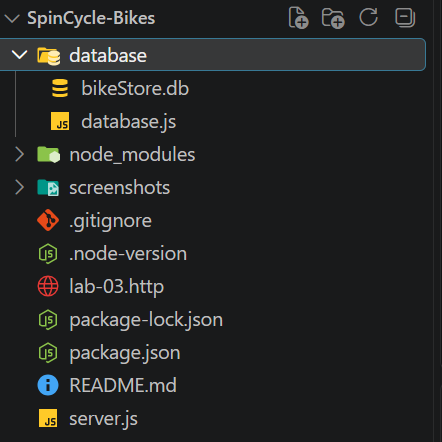  
*Figure 1 (`01-project-structure.png`): Approved `SpinCycle-Bikes` workspace structure in VS Code.*

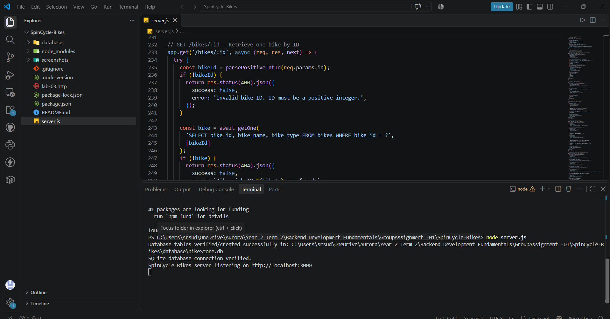  
*Figure 2 (`02-server-startup.png`): Successful Express server startup and SQLite connection verification on `http://localhost:3000`.*

#### API Testing

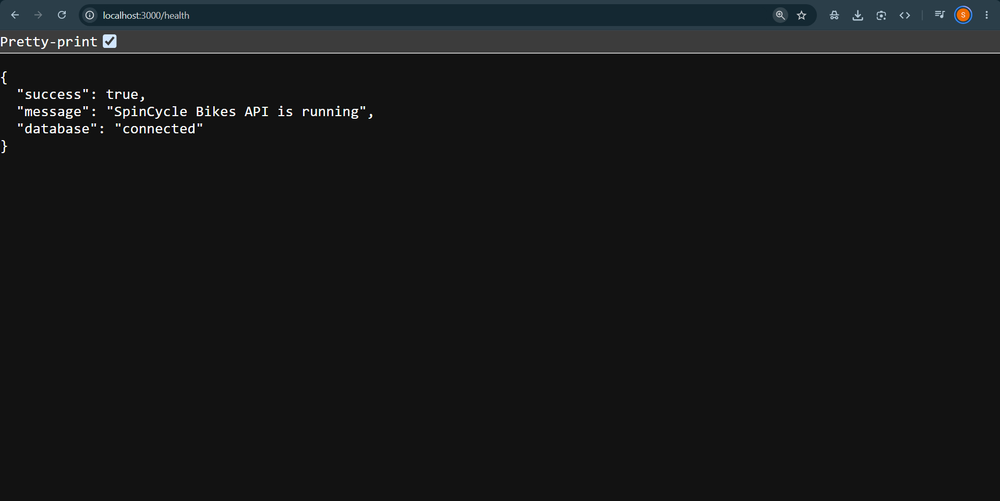  
*Figure 3 (`03-health-check.png`): `GET /health` returning `200 OK` with `"database": "connected"`.*

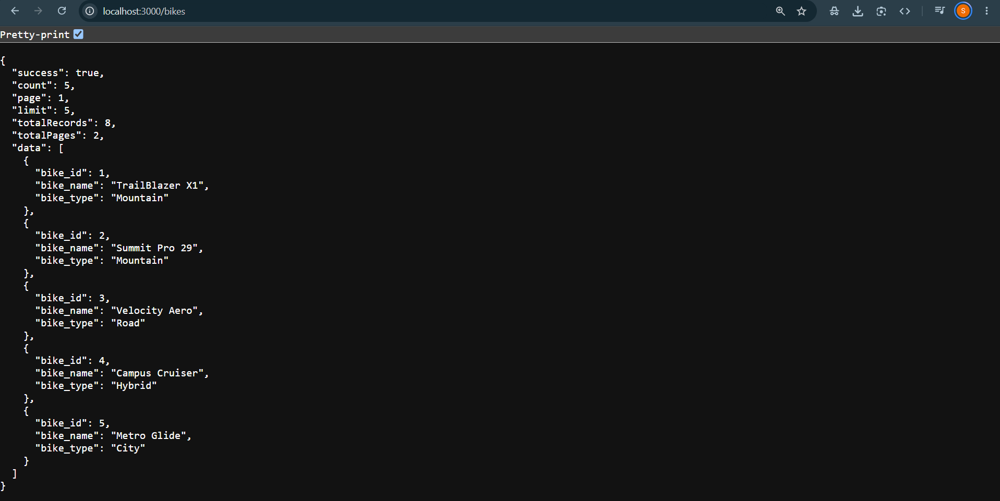  
*Figure 4 (`04-get-bikes-default.png`): `GET /bikes` using default pagination (`page=1`, `limit=5`, `totalRecords=8`, `totalPages=2`).*

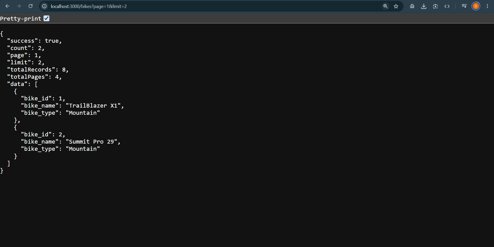  
*Figure 5 (`05-bikes-pagination-page1.png`): `GET /bikes?page=1&limit=2` returning `bike_id` 1 and 2 (`totalPages=4`).*

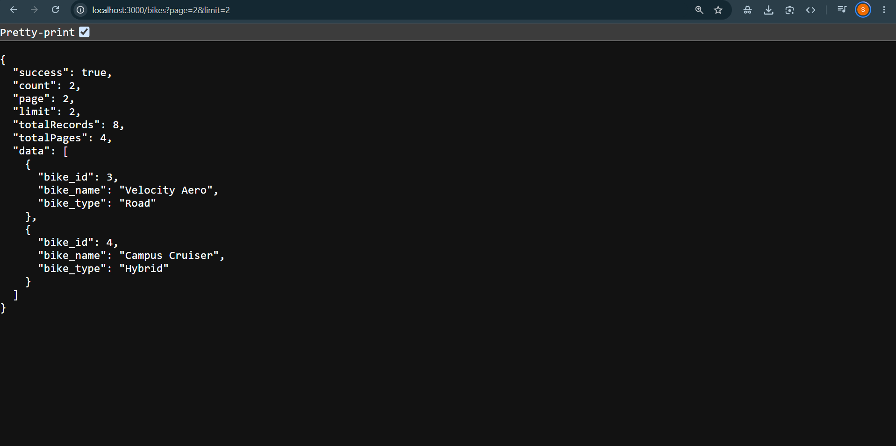  
*Figure 6 (`06-bikes-pagination-page2.png`): `GET /bikes?page=2&limit=2` returning `bike_id` 3 and 4 without duplicates.*

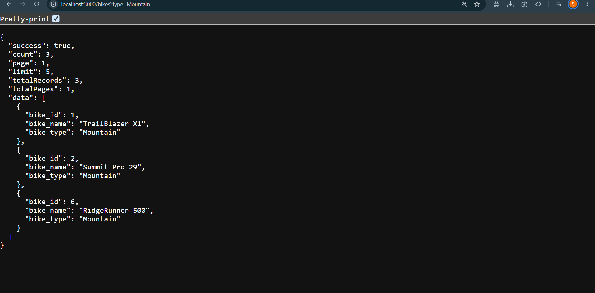  
*Figure 7 (`07-bikes-search-mountain.png`): `GET /bikes?type=Mountain` returning all 3 Mountain bicycles.*

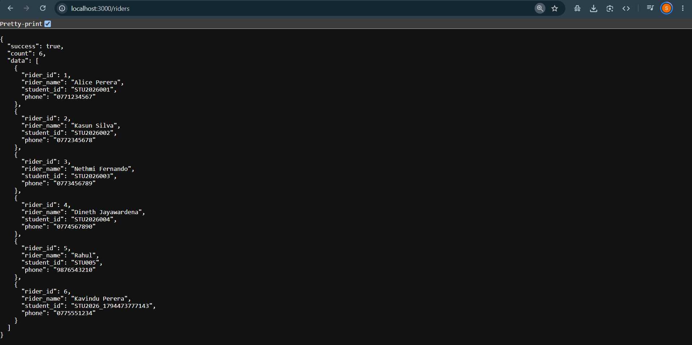  
*Figure 8 (`08-get-riders.png`): `GET /riders` returning all 6 registered rider records.*

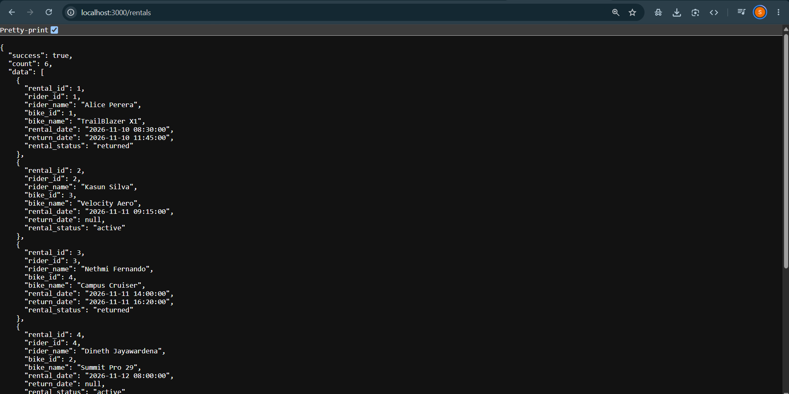  
*Figure 9 (`09-get-rentals-join.png`): `GET /rentals` returning 6 rental records joined with `rider_name` and `bike_name`.*

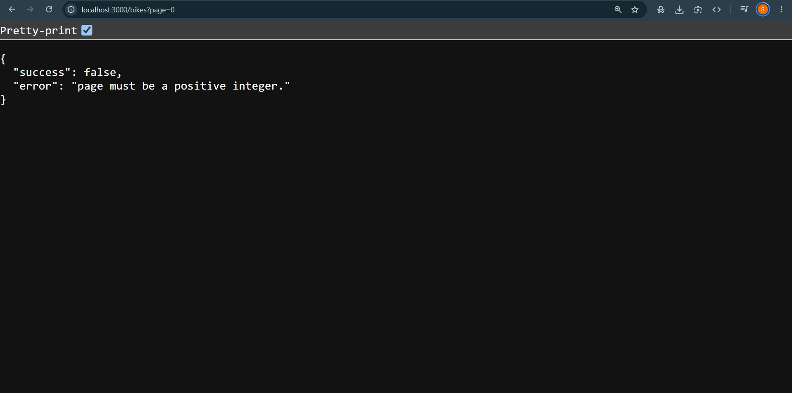  
*Figure 10 (`10-pagination-validation.png`): `GET /bikes?page=0` returning validation error `"page must be a positive integer."`.*

#### Database Verification (Read-Only SQLite CLI)

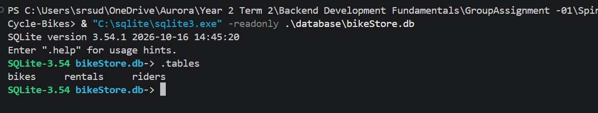  
*Figure 11 (`11-database-tables.png`): `.tables` in read-only SQLite CLI confirming `bikes`, `rentals`, and `riders`.*

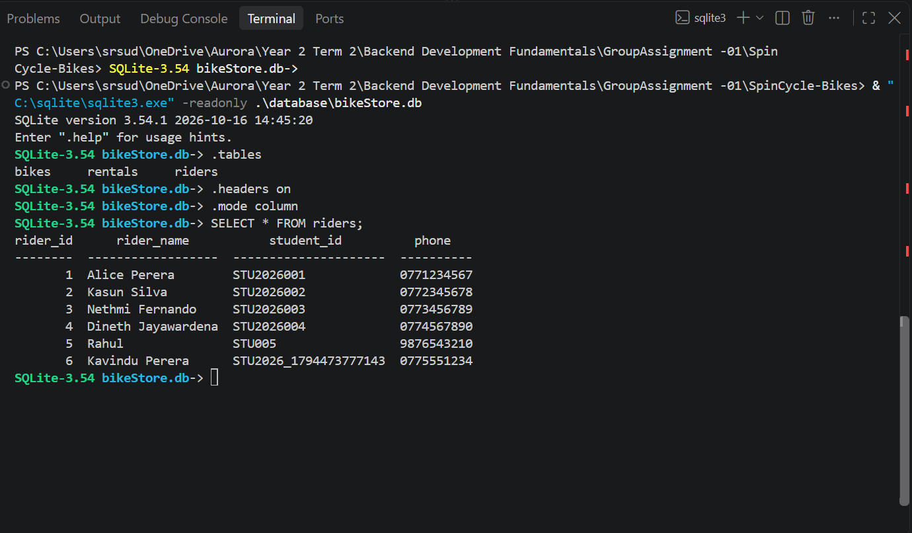  
*Figure 12 (`12-riders-records.png`): `SELECT * FROM riders;` showing all 6 verified rider records.*

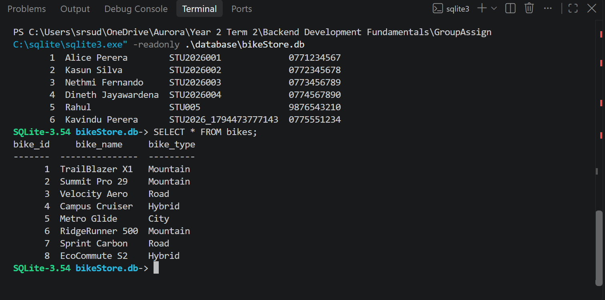  
*Figure 13 (`13-bikes-records.png`): `SELECT * FROM bikes;` showing all 8 verified bike records.*

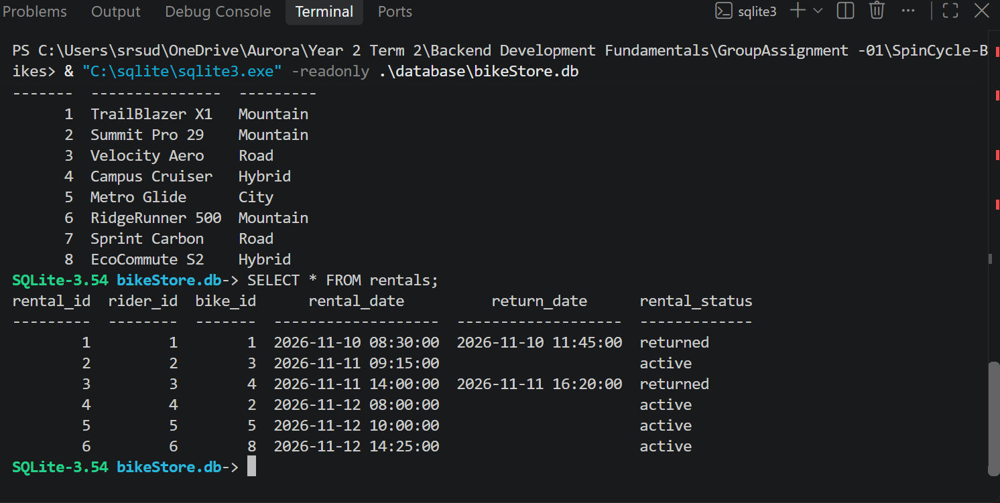  
*Figure 14 (`14-rentals-records.png`): `SELECT * FROM rentals;` showing all 6 verified rental records.*

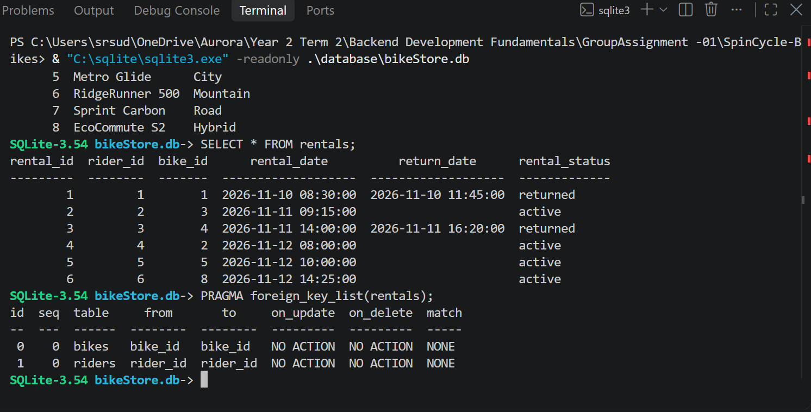  
*Figure 15 (`15-database-relationships.png`): `PRAGMA foreign_key_list(rentals);` confirming foreign keys to `bikes(bike_id)` and `riders(rider_id)` with `NO ACTION`.*

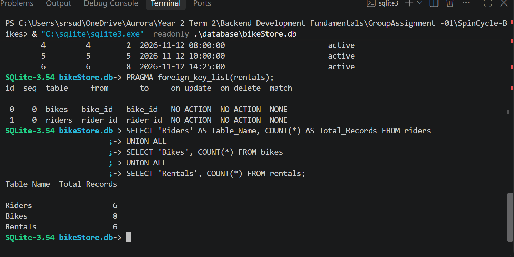  
*Figure 16 (`16-database-record-counts.png`): `COUNT(*)` query confirming `Riders: 6`, `Bikes: 8`, `Rentals: 6`.*

---

## 12. Group Members and Individual Contributions

| Member | Full Name | Registration Number | Section | Assigned Responsibility | Technical Contribution |
|---|---|---|---|---|---|
| **Member 1** | Sirigineedi Venkata Rama Kishore | `252U1R1230` | `CSE-CORE-2E` | Server and Routes | Set up the Express.js application in `server.js`, configured JSON middleware, created `routes.js`, registered all API routes for riders, bikes, and rentals, implemented 404 route handling, centralized error middleware, and database-gated server startup. |
| **Member 2** | Shaik Irfan Basha | `252U1R1228` | `CSE-CORE-2E` | Database | Designed the three-table normalized schema (`riders`, `bikes`, and `rentals`) in `database/database.js`, enabled SQLite foreign-key enforcement, implemented Promise-based query helpers (`runQuery`, `getOne`, `getAll`), and configured idempotent database initialization for `database/bikeStore.db`. |
| **Member 3** | Settipalli Dinesh Kumar | `252U1R1227` | `CSE-CORE-2E` | REST Endpoints | Implemented all REST endpoint operations in `endpoints.js`: bike CRUD operations (`GET`, `POST`, `PUT`, `DELETE`), rider endpoints, rental creation with conflict checks, and the rental `INNER JOIN` query returning rider and bike names. |
| **Member 4** | Siddi Lakshmi Prasanna | `252U1R1229` | `CSE-CORE-2E` | Validation and Search | Built reusable validation and search functions in `validation.js`: integer ID validation, required-field validation for bikes and riders, calendar date verification for rentals, conflict validation, and parameterized case-insensitive bike-type search (`WHERE LOWER(bike_type) = LOWER(?)`). |
| **Member 5** | Vemula Anshu | `252U1R1254` | `CSE-CORE-2E` | Pagination | Implemented the pagination module in `pagination.js`: reading `page` and `limit` query parameters, default values (`page=1`, `limit=5`), offset formula `(page - 1) * limit`, totalRecords and totalPages metadata calculation, and pagination validation ensuring all mandatory tests pass. |
| **Member 6** | Somula Sudharshan Reddy | `252U1R1231` | `CSE-CORE-2E` | Postman and README | Created the 40-request Postman Collection in `postman/SpinCycle-Bikes.postman_collection.json`, executed the automated test suite in `postman/POSTMAN_TEST_REPORT.md` (42/42 passed: 36 core + 6 lifecycle CRUD), maintained testing evidence and screenshots, and authored the project `README.md`. |

### Member-Wise Contribution & Ownership Guide

To ensure clean collaboration and make each student's work easy to explain during demonstration, the project divides codebase ownership into six distinct modules:

#### Member 1 — Sirigineedi Venkata Rama Kishore (`252U1R1230`): Server and Routes
- **Files Owned:** `server.js`, `routes.js`
- **Functions / Responsibilities Implemented:** Express initialization, `express.json()` body parsing, router configuration, route-to-handler bindings (`routes.js`), 404 catch-all handler, centralized error handling middleware (`err.type === 'entity.parse.failed'` and status 500 fallback), and `startServer()` database-gated bootstrap.
- **Interfaces Coordinated:** Imports `endpoints` from `endpoints.js` (Member 3) to mount on routes; imports `initializeDatabase` and `getOne` from `database/database.js` (Member 2) for startup connectivity verification.
- **Pre-Commit Verification:** Run `npm start` and verify server startup output, test `GET /health` (`200 OK`), test unknown routes for `404 Not Found`, and verify malformed JSON body rejection (`400 Bad Request`).

#### Member 2 — Shaik Irfan Basha (`252U1R1228`): Database
- **Files Owned:** `database/database.js`, `database/bikeStore.db`
- **Functions / Responsibilities Implemented:** SQLite connection creation, `PRAGMA foreign_keys = ON` execution, `CREATE TABLE IF NOT EXISTS` DDL for `riders`, `bikes`, and `rentals`, idempotent `seedInitialData()` logic, and Promise-wrapped database query helpers: `runQuery()`, `getOne()`, and `getAll()`.
- **Interfaces Coordinated:** Exports `runQuery`, `getOne`, `getAll`, and `initializeDatabase` to `endpoints.js` (Member 3) and `server.js` (Member 1).
- **Pre-Commit Verification:** Run `node database/database.js` directly to verify standalone table creation and verify SQLite schema and record counts via read-only queries (`SELECT COUNT(*) FROM ...`).

#### Member 3 — Settipalli Dinesh Kumar (`252U1R1227`): REST Endpoints
- **Files Owned:** `endpoints.js`
- **Functions / Responsibilities Implemented:** Endpoint business logic and SQL execution: `getHealth()`, `getBikes()`, `getBikeById()`, `createBike()`, `updateBike()`, `deleteBike()` (with rental history preservation), `getRiders()`, `getRiderById()`, `createRider()`, `getRentals()` (with SQL `INNER JOIN`), and `createRental()` (with active rental conflict checks).
- **Interfaces Coordinated:** Consumes `runQuery`, `getOne`, `getAll` from `database/database.js` (Member 2); consumes validation helpers from `validation.js` (Member 4); consumes `parseBikeQueryParams` and `buildPaginationMetadata` from `pagination.js` (Member 5); exports all handlers to `routes.js` (Member 1).
- **Pre-Commit Verification:** Test full CRUD for `/bikes`, verify `GET /rentals` returns joined `rider_name` and `bike_name`, test active rental conflict (`409 Conflict`), and test deletion conflict on bike 1 (`409 Conflict`).

#### Member 4 — Siddi Lakshmi Prasanna (`252U1R1229`): Validation and Search
- **Files Owned:** `validation.js`
- **Functions / Responsibilities Implemented:** `parsePositiveIntId()`, `parsePositiveIntField()`, `validateNonEmptyString()`, `validateBikePayload()`, `validateRiderPayload()`, `validateRentalDate()` (calendar verification rejecting invalid dates like `2026-02-30`), `validateBikeTypeSearch()`, and `buildBikeTypeSearchClause()`.
- **Interfaces Coordinated:** Supplies validation helpers to `endpoints.js` (Member 3); supplies `parsePositiveIntId` and `validateBikeTypeSearch` to `pagination.js` (Member 5).
- **Pre-Commit Verification:** Test empty bike name (`400 Bad Request`), test empty bike type (`400 Bad Request`), test invalid ID strings (e.g. `/bikes/abc`), test case-insensitive search (`?type=Mountain` and `?type=road`), and test empty search string (`?type=%20%20` returning `400 Bad Request`).

#### Member 5 — Vemula Anshu (`252U1R1254`): Pagination
- **Files Owned:** `pagination.js`
- **Functions / Responsibilities Implemented:** Constants `DEFAULT_PAGE = 1` and `DEFAULT_LIMIT = 5`, `parsePaginationParam()`, `calculateOffset()`, `buildPaginationMetadata()`, and `parseBikeQueryParams()`.
- **Interfaces Coordinated:** Uses `parsePositiveIntId` and `validateBikeTypeSearch` from `validation.js` (Member 4); exports `parseBikeQueryParams` and `buildPaginationMetadata` to `endpoints.js` (Member 3).
- **Pre-Commit Verification:** Run all three mandatory pagination tests:
  1. `GET /bikes?page=1&limit=2` (returns `bike_id` 1 and 2, status `200`)
  2. `GET /bikes?page=2&limit=2` (returns `bike_id` 3 and 4 without duplicates, status `200`)
  3. `GET /bikes?page=0` (status `400 Bad Request`)
  4. Negative limit `GET /bikes?limit=-2` (status `400 Bad Request`)

#### Member 6 — Somula Sudharshan Reddy (`252U1R1231`): Postman and README
- **Files Owned:** `postman/SpinCycle-Bikes.postman_collection.json`, `postman/POSTMAN_TEST_REPORT.md`, `test.js`, `README.md`
- **Functions / Responsibilities Implemented:** Created the 40-request Postman Collection v2.1.0 across 10 folders with automated test scripts and collection variables; authored the reproducible automated test runner `test.js` verifying all 42 test cases (36 core + 6 lifecycle CRUD) in `postman/POSTMAN_TEST_REPORT.md` (100% PASS); maintained testing evidence and verified screenshots in `screenshots/`; authored and structured the comprehensive academic `README.md`.
- **Interfaces Coordinated:** Verifies that all endpoints from Member 1, Member 2, Member 3, Member 4, and Member 5 operate accurately together and documents instructions for installation, execution, and API testing.
- **Pre-Commit Verification:** Run `npm test` or `node test.js` to verify all 42 test cases pass; validate that `postman/SpinCycle-Bikes.postman_collection.json` is valid JSON and importable; verify all 16 screenshot links render on GitHub; verify all PowerShell setup and startup commands run without errors.

### Teamwork and Integration

The codebase is structured into modular components matching the group's division of labor: the database schema and Promise helpers (`database/database.js` — Member 2) provide the foundation for the Express server and central router (`server.js`, `routes.js` — Member 1) and endpoint business logic (`endpoints.js` — Member 3), which are protected by input validation and bike search (`validation.js` — Member 4), equipped with query-driven pagination (`pagination.js` — Member 5), and verified end-to-end through automated test suites (`test.js`), Postman collection and report (`postman/`), screenshots (`screenshots/`), and documentation (`README.md` — Member 6).

---

## 13. Learning Outcomes

Through completing **SpinCycle Bikes**, the group gained hands-on experience in:

- **Node.js & Express.js Server Development:** Structuring an Express 5 server, configuring JSON middleware, managing async route handlers, and implementing centralized error handling.
- **REST API Design:** Designing noun-based resource endpoints (`/bikes`, `/riders`, `/rentals`, `/health`) with standard HTTP methods and status codes.
- **SQLite Database Operations:** Using `sqlite3` in Node.js with Promise wrappers (`runQuery`, `getOne`, `getAll`) and parameterized queries.
- **Relational Database Design:** Modeling normalized entities (`riders`, `bikes`, `rentals`) with primary keys, `UNIQUE` constraints, and foreign keys.
- **SQL Queries & `INNER JOIN` Operations:** Writing multi-table `INNER JOIN` queries to combine relational data cleanly at query time.
- **CRUD Operations:** Implementing Create, Read, Update, and Delete workflows with referential-integrity protection.
- **Input Validation:** Validating route parameters, request body objects, strings, integers, and real calendar dates before touching the database.
- **Error Handling:** Returning structured `400`, `404`, `409`, `500`, and `503` JSON responses without exposing sensitive internals.
- **Search & Pagination:** Implementing case-insensitive SQL filtering (`LOWER(...)`) and deterministic `LIMIT`/`OFFSET` pagination with `COUNT(*)` metadata.
- **API Testing:** Verifying success, edge, and failure cases systematically using `assignment-01.http`, automated test suite (`test.js`), Postman, browser checks, and read-only SQLite CLI queries.
- **Team Collaboration:** Coordinating six distinct backend and QA responsibilities into a single cohesive repository.
- **Technical Documentation:** Producing clear, accurate, code-verified engineering documentation in Markdown and Mermaid.

---

## 14. Project Scope and Limitations

### Current Scope (Implemented)

- Local Express.js JSON REST API running on `http://localhost:3000`.
- Persistent SQLite database (`database/bikeStore.db`) with `riders`, `bikes`, and `rentals`.
- Full CRUD for `/bikes`, read + create for `/riders`, and read (`INNER JOIN`) + create (`active`) for `/rentals`.
- Case-insensitive exact-type bike search (`?type=`) and `LIMIT`/`OFFSET` pagination (`?page=&limit=`).
- Input validation, conflict checks (`409`), and parameterized SQL queries.

### Current Limitations

- **No Return / Close Rental Endpoint:** `POST /rentals` creates `'active'` rentals with `return_date: null`; there is no `PUT` or `PATCH` endpoint to mark an active rental as `'returned'`.
- **No Rider Update/Delete Endpoints:** `GET /riders`, `GET /riders/:id`, and `POST /riders` are implemented; `PUT` and `DELETE` for riders are outside the current scope.
- **Exact-Type Search Only:** `GET /bikes?type=...` performs a case-insensitive exact match (`LOWER(bike_type) = LOWER(?)`) rather than partial substring matching or searching by `bike_name`.
- **No Authentication or Authorization:** Endpoints are open for local academic demonstration without login, sessions, or JWTs.
- **No Frontend UI or External Integrations:** There is no web/mobile UI, payment gateway, GPS tracking, or admin dashboard.
- **Hardcoded Local Port:** `PORT = 3000` is defined directly in `server.js` without environment-variable configuration.

### Possible Future Enhancements *(Not Currently Implemented)*

- Add a `PATCH /rentals/:id/return` (or `PUT /rentals/:id`) endpoint to record `return_date` and transition `rental_status` from `'active'` to `'returned'`.
- Add `PUT /riders/:id` and `DELETE /riders/:id` (with rental-history protection).
- Support partial keyword search (`LIKE`) and availability filtering (`?available=true`) on `GET /bikes`.
- Add pagination to `GET /riders` and `GET /rentals`.
- Introduce authentication/role-based access control and environment-based port/database configuration.

---

## 15. Conclusion

**SpinCycle Bikes** delivers a clean, reliable backend foundation for campus bicycle sharing using **Node.js**, **Express.js**, and **SQLite**. By replacing informal paper-notebook borrowing logs with a normalized three-table database, foreign-key enforcement, active-rental conflict prevention, rental-history preservation, and a fully validated REST API with search and pagination, the project demonstrates how core backend engineering principles solve real-world record-management problems. Together, the six members of **Group 03 (`YG-CSE2E-G03`)** combined database design, route implementation, validation, pagination, testing, and documentation into a cohesive academic REST service.
